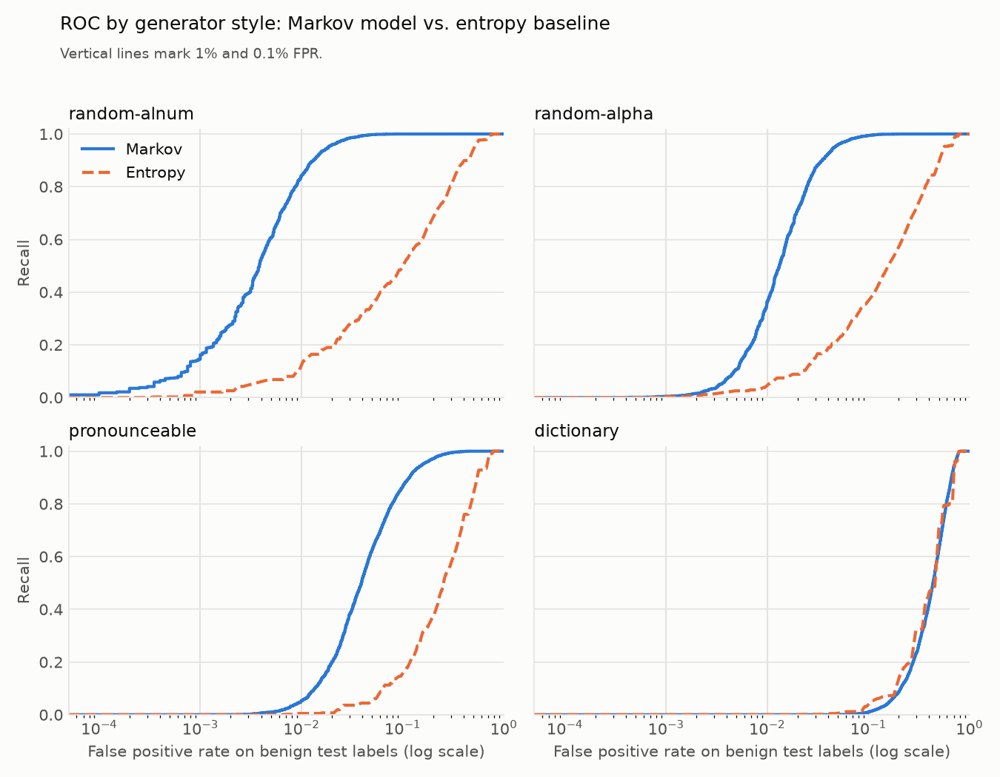

# dgalens

Flag algorithmically generated domains (DGA domains) with a character-level Markov model.

Malware often finds its command-and-control server by generating hundreds of pseudo-random domains a day, such as `q8f7g2kd9s1m.net`, and trying each one. Human-chosen names follow the letter patterns of real words. Generated names usually don't. `dgalens` learns those patterns from popular legitimate domains and flags names that don't fit.

```console
$ dgalens score google.com paypal-login-secure.com q8f7g2kd9s1m.net kmbvkhwrcxqjlz.info
 -0.9671  ok          google.com
 -1.9605  ok          paypal-login-secure.com
 -8.8686  SUSPICIOUS  q8f7g2kd9s1m.net
 -6.2705  SUSPICIOUS  kmbvkhwrcxqjlz.info
```

`dgalens` ships as a CLI for training, scoring and evaluation, plus a small FastAPI service. The core model is about 150 lines of dependency-free Python.

## How it works

1. **Normalise.** `https://mail.example.co.uk/login` becomes `example`. DGAs randomise the registrable label, so that's the part that gets scored. The public suffix list is handled by `tldextract`, using its bundled offline snapshot.
2. **Model.** An order-3 character Markov chain estimates `P(next char | previous 3 chars)`, padded with start and end markers so it also learns how labels begin and end.
3. **Smoothing.** The model interpolates from the full 3-character context down through shorter contexts:

   `P(c | h) = (count(h, c) + α · P(c | shorter h)) / (count(h) + α)`

   An unseen context therefore backs off to what shorter contexts predict, instead of to a uniform guess. This mattered a lot in practice. With plain add-α smoothing, an order-3 model caught only about 5% of random labels at a 1% false-positive rate, because every unseen context looked equally plausible. With interpolation it catches 92% at the calibrated threshold (see [Results](#results)).

4. **Score.** The score is the mean log-probability per character, so long and short labels are comparable. Lower means less word-like.
5. **Threshold.** `train` holds out 10% of the benign data and sets the threshold so that about 1% of it would be flagged (`--fpr`).
6. **Short labels.** Labels under 6 characters (`x7`, `k4g`) never get flagged. They carry too little signal, and legitimate short domains are common.

## Quick start

Requires Python 3.12+ and [uv](https://docs.astral.sh/uv/).

```sh
uv sync
uv run python scripts/fetch_tranco.py      # benign data -> data/
uv run dgalens train data/benign-train.csv # model -> models/dgalens.json

uv run dgalens score example.com xjq9v2kp7z.com
cat domains.txt | uv run dgalens score --suspicious --json
```

### API

```sh
uv run uvicorn dgalens.api:app
curl -s localhost:8000/score -H 'content-type: application/json' -d '{"domain": "xjq9v2kp7z.com"}'
# {"domain":"xjq9v2kp7z.com","label":"xjq9v2kp7z","score":-5.49,"suspicious":true}
```

| Method | Path           | Body                                     |
| ------ | -------------- | ---------------------------------------- |
| `POST` | `/score`       | `{"domain": "..."}`                      |
| `POST` | `/score/batch` | `{"domains": ["...", ...]}` (up to 1000) |
| `GET`  | `/health`      |                                          |

Interactive docs are served at `/docs`.

### Docker

The image downloads the Tranco list and trains the model at build time:

```sh
docker build -t dgalens . && docker run -p 8000:8000 dgalens
```

## Results

**Setup.** The model is trained on the top 100,000 domains of the [Tranco list](https://tranco-list.eu): 90% for training and 10% to calibrate a 1% false-positive target. The benign test set is the next 20,000 ranks (100,001–120,000), which the model never sees. The calibrated threshold flags 1.47% of it, a little over target because less popular domains look less word-like.

**Generated test sets.** There are 5,000 labels per style from [`dgalens.synthetic`](src/dgalens/synthetic.py), with seed 0. They are style proxies written for this project, not reimplementations of real generators. Their specs were fixed before any results were seen.

| Style           | Spec                                         |
| --------------- | -------------------------------------------- |
| `random-alnum`  | uniform `[a-z0-9]`, 8–16 chars               |
| `random-alpha`  | uniform `[a-z]`, 8–16 chars                  |
| `pronounceable` | consonant–vowel syllables, 8–14 chars        |
| `dictionary`    | two common English words joined (`firmlake`) |

**Baseline.** The Shannon entropy of the label's characters, which ignores their order. If the Markov model can't beat it, modelling transitions isn't helping.

Each cell shows Markov / entropy:

| Style           | ROC AUC       | Recall @ 1% FPR | Recall @ 0.1% FPR | Recall @ calibrated threshold |
| --------------- | ------------- | --------------- | ----------------- | ----------------------------- |
| `random-alnum`  | 0.994 / 0.838 | 84.0% / 10.5%   | 14.5% / 2.1%      | 92.1%                         |
| `random-alpha`  | 0.982 / 0.786 | 36.0% / 3.8%    | 0.4% / 0.3%       | 55.8%                         |
| `pronounceable` | 0.945 / 0.709 | 5.2% / 0.5%     | 0.0% / 0.0%       | 11.7%                         |
| `dictionary`    | 0.564 / 0.574 | 0.0% / 0.0%     | 0.0% / 0.0%       | 0.0%                          |



What the numbers say:

- **Character order carries the signal.** The Markov model beats the entropy baseline on every style except `dictionary`, by a wide margin at every operating point.
- **ROC AUC flatters.** Pronounceable labels reach an AUC of 0.945, so the model ranks them below most legitimate domains. Yet only 5% are caught at 1% FPR, because the least word-like legitimate domains score just as low. Read the recall columns, not the AUC.
- **Low false-positive rates are hard.** At 0.1% FPR, about 20 benign domains in this test set, only `random-alnum` keeps any meaningful recall. Partly this is because the lowest-scoring Tranco domains often look machine-generated themselves (`itrnznre.top`, `afxiocmvsd.monster`). A popularity list isn't a clean list of legitimate sites, so these rates are somewhat pessimistic. 0.01% isn't reported, since it would rest on 2 domains.
- **Dictionary-based names are at chance level** for both methods, as expected (see [Limitations](#limitations)).

Rates are computed over all benign labels, including the 20% shorter than 6 characters, which are never flagged. That matches what the detector does in practice.

Reproduce with:

```sh
uv run python scripts/fetch_tranco.py
uv run dgalens train data/benign-train.csv
uv run --group eval python scripts/evaluate.py --plot docs/roc.png
```

## Limitations

- **Dictionary DGAs aren't caught.** Some generators build names by joining real words (`mantleshake.net`). They look natural character by character, so a character-level model can't separate them (ROC AUC 0.56).
- **Letters-only and pronounceable labels are much harder than alphanumeric ones.** Digits mixed with letters are a strong signal. Without them, recall at 1% FPR drops from 84% to 36%, and to 5% for pronounceable labels.
- **The evaluation data is synthetic.** The generated sets are this project's own approximations of each style, so the numbers measure those approximations, not real-world traffic.
- **The model is biased toward English.** Legitimate domains in other languages or transliterations score lower. Training on a regionally appropriate list helps.
- **Each domain is scored alone.** Real DGA detection also uses NXDOMAIN rates, query timing and many-domains-per-host patterns. `dgalens` is one signal, not a verdict.

## Roadmap

- [x] Evaluate against synthetic DGA-style data (random, pronounceable and dictionary-based), with per-style recall, ROC curves and an entropy baseline.
- [ ] Check against an independent labelled DGA dataset, if one with a compatible licence turns up.
- [ ] Compare order and smoothing settings on the per-style data.
- [ ] Add a `generate` command that samples plausible-looking labels from the chain, e.g. for typosquat and lookalike testing.

## Development

```sh
uv run pytest && uv run ruff check . && uv run ruff format --check . && uv run mypy src
```

## License

MIT
